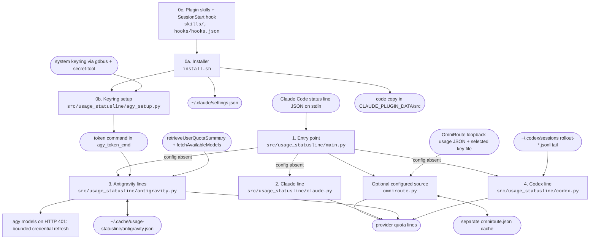
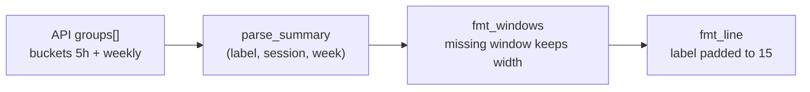

# Architecture

## Optional OmniRoute source (0.3.0)

`main.py` calls `omniroute.omniroute_lines()` before reading stdin. Absence of
`~/.config/usage-statusline/omniroute.json` returns `None` and preserves the native path
described below. An existing config selects only its mapped OmniRoute connections; output
or failure returns immediately without native readers by default. This avoids assuming that a router
account matches a native account. A malformed config is an error, not fallback. The one exception
is a failed router fetch (`n/a (fetch failed)`, for example OmniRoute is not running): `main.py`
hides every OmniRoute line, stale rows included, and prints only the native Claude, Antigravity
and Codex rows. `main.py` also filters every row through `UNUSABLE` markers (`n/a (`, `stale (`,
`no usage yet`, `usage appears after`), so a provider that is missing, logged out or stale leaves
no line, and the output is empty when no source has live data. Those rows are not tied to the mapped router accounts.

The optional boolean `native_ag_argon_fallback` defaults to false and is strictly validated.
When explicitly enabled with exactly one selected `agy` connection, an unavailable Argon row
without usable router-cached history can use only the Argon row from
`antigravity.antigravity_line()`. `_native_row()` catches native failures, filters out
unavailable rows, and preserves the body and native stale annotation under `AG Argon local`
plus the selected alias. The optional boolean `native_ag_gemini_fallback` follows the same
rules: when the router sends no `gemini_weekly`, a native `AG Gemini` row with a weekly
percentage replaces the router row as `AG Gemini local`. No native Claude/GPT row is substituted. Native quota
requests and credential recovery can run in this opt-in mode. Account identity cannot be
matched across sources; operators must ensure local `agy` and the selected router account
are the same. Multiple selected AG accounts disable this fallback. Local rows share the
existing per-row cache validation and throttle, and retain stale history on later failures.

`omniroute.py` owns config/key validation, a fixed authenticated loopback GET, exact
connection/provider matching, quota conversion and its separate private cache. It uses only
the standard library and the existing shared formatters in `claude.py`. `parse_connection`
returns one selected connection's complete formatted rows; `fetch_snapshot` reads the local
usage JSON; `omniroute_lines` combines selected rows, stale history and errors. No installer,
hook, native provider API or credential-refresh changes are needed.

Transport is pinned to `127.0.0.1:20128/api/usage/om-usage?format=json`, with a two-second
timeout, disabled environment proxies and rejected redirects. The referenced usage key is
kept in memory only and sent in an unredirected Bearer header. A scoped usage-capable key
is required; quotaline never imports router/provider credentials or changes permissions.
Static errors cannot expose response bodies, key material or connection identities.

Claude and Codex quota aggregates use percent units. Codex `windowSeconds` controls column
placement and duration labels. AG uses precise `remainingPercentage`, requires agreement
across each session family and uses explicit weekly keys when present. Argon remains weekly
only. Each AG row is parsed independently: absent windows display `--`, while malformed or
inconsistent values, or two absent windows, fail that row. No arbitrary model is selected.
`parse_connection` can validate one AG label; its default still validates all selected rows.

`~/.cache/usage-statusline/omniroute.json` stores only selected formatted rows, opaque IDs,
local receipt/attempt times and a configuration fingerprint. Successful and failed attempts
are throttled 60 s; config changes invalidate scope. Atomic 0600 replacement and optional writes
preserve output when storage fails. Partial failures retain only that connection's previous
complete rows with `stale (received …)` and current error; successful connections update.
Within AG, successful rows refresh independently and failed rows retain their own cached
value and receipt time (`row_times`), or show a row-specific error without history. If every
AG row fails or its connection is unavailable, stale rows accompany one `AG` error. Aliases
apply to row and error labels. Cache-hit validation accepts these row errors and stale rows;
older records without `row_times` use the connection receipt time for each row.
The header always says `upstream age unknown`. A cached GET supplies no upstream observation
time, so receipt/reset time never proves freshness and past resets never fabricate 0% usage.

Deployment is unchanged: clone installs execute their source, plugin sync copies the whole
package including this module. Operators opt in by creating the config/key files and can
restore native mode by removing the config. No automatic local activation or service startup.

## Complete Antigravity groups (0.2.2)

Quota requests use the verified `antigravity/cli/1.4.2` User-Agent. Live checks on
2026-10-18 showed that the bare `antigravity` header omitted Gemini and Argon summary groups.
`parse_summary` recognizes `gemini-argon-` before the generic `gemini` prefix, so Argon keeps
its own `AG Argon` row and successful-cache key. Its weekly bucket does not imply a session
window. Existing Gemini/Claude labels, unknown-group fallback and missing-Gemini model
fallback remain unchanged. This header is fixed; no CLI-version subprocess is needed.
The complete summary normally needs one quota request instead of the old header's summary
plus model fallback (two requests); neither path makes inference calls.

## Antigravity reliability update (0.2.1)

`antigravity.py` retains the summary endpoint and supplements absent Gemini groups with
`fetchAvailableModels` on the same host. Model data uses a generic quota label, since it
provides no weekly window. HTTP 401 permits one bounded, non-interactive `agy models` attempt;
`agy` retains OAuth/keyring ownership. Cache writes are atomic and optional; successful rows
survive failures with observation timestamps and stale markers. `main.py` isolates Claude and
Antigravity exceptions so the other providers still render, and treats non-object stdin as `{}`. Installer, hook, skills and module entry points are unchanged.
The original API reference and historical verification notes below describe 0.2.0 unless noted.

## Overview
The following overview describes native mode when OmniRoute is unconfigured.
Claude Code runs a status line command after each update and every 60 seconds. It sends session
JSON to the command on stdin. `usage_statusline` prints provider quota lines. The first shows
Claude Pro 5-hour and 7-day usage from that JSON. The others show one Antigravity (`agy`) quota
group each (Gemini, Claude/GPT, and Argon) with its available 5-hour and weekly usage, fetched
from Google's Code Assist API and cached; Gemini model fallback can add separate quota rows.
The last shows Codex CLI usage, read from the tail of Codex's own session
transcripts, with no network request. `install.sh` wires the command into
`~/.claude/settings.json`. The same repository is published as the Claude Code plugin `quotaline`, and it's also its
own marketplace (`quotaline@mlemes`), whose skills run `install.sh` for you. It's built to pair
with the `antigravity-for-claude-code` plugin and OpenAI's Codex plugin (`codex-plugin-cc`), which
hand work off from Claude Code to `agy` and Codex, so you can watch and balance all three quotas.

## Diagram

| Stage | Module | Reads | Writes |
|---|---|---|---|
| 0a. Installer | `install.sh` | `~/.claude/settings.json` | `statusLine` key, one-time `.bak-usage-statusline` backup, `DIR/src` with `--dest` |
| 0c. Plugin | `skills/install`, `skills/uninstall`, `hooks/hooks.json` | `${CLAUDE_PLUGIN_ROOT}` | runs `install.sh --dest ${CLAUDE_PLUGIN_DATA}` (`--sync` at session start) |
| 0b. Keyring setup | `src/usage_statusline/agy_setup.py` | keyring labels and attributes, one secret lookup | `~/.config/usage-statusline/agy_token_cmd` |
| 1. Entry point | `src/usage_statusline/main.py` | source selection, native stdin JSON | stdout |
| Optional router source | `src/usage_statusline/omniroute.py` | explicit config, selected key file, loopback usage JSON, own cache | selected rows and own cache |
| 2. Claude line | `src/usage_statusline/claude.py` | `rate_limits` in the JSON | one line, plus the shared column layout |
| 3. Antigravity lines | `src/usage_statusline/antigravity.py` | token command, API, cache | cache file, one line per quota group |
| 4. Codex line | `src/usage_statusline/codex.py` | last 256 KiB of up to 3 newest `rollout-*.jsonl` | one line, or nothing without `~/.codex/sessions` |

Core structure (one quota group after parsing, rendered with the shared layout):

## Modules
| Module | Responsibility | Status |
|---|---|---|
| `src/usage_statusline/main.py` | Selects configured OmniRoute mode or the existing native stdin/provider path | built |
| `src/usage_statusline/omniroute.py` | Validates explicit mapping, reads local usage JSON, preserves quota semantics and mapping-bound stale rows | optional in 0.3.0 |
| `src/usage_statusline/codex.py` | Finds the newest Codex `token_count` rate limits and formats one line, with rollover and plan-dependent window labels | built (9 tests), verified on real free-plan and Go-plan transcripts on 2026-09-28 |
| `src/usage_statusline/claude.py` | Formats the Claude 5-hour and 7-day windows, and owns the aligned layout shared by all lines | built (4 tests) |
| `src/usage_statusline/antigravity.py` | Gets and decodes the token, calls the API, parses quota groups, and caches the lines | built; summary and model fallback, bounded credential recovery, atomic stale cache, verified live on 2026-10-17 |
| `src/usage_statusline/agy_setup.py` | Finds the agy keyring entry and saves the token command | built (12 tests), verified on the real keyring on 2026-09-27 |
| `src/usage_statusline/settings_entry.py` | Adds or removes the `statusLine` key in `settings.json`, run by `install.sh` | built (2 tests) |
| `install.sh` | Installs or uninstalls the settings entry through `settings_entry`, then runs `agy_setup`. With `--dest`, runs from a copy | built (6 tests) |
| `.claude-plugin/`, `skills/`, `hooks/` | Plugin manifest, `mlemes` marketplace, install and uninstall skills, and the sync hook | built (2 tests in `test_plugin.py`), `claude plugin validate .` passes |

### Public API of what is built
- `omniroute.omniroute_lines(config: Path = CONFIG, cache: Path = CACHE, now: float | None = None) -> str | None`: `None` only for absent config; otherwise one source header, selected rows and sanitized errors, with 60 s attempt throttle and per-connection stale retention and independent AG row receipts.
- `omniroute.fetch_snapshot(key: str) -> dict`: fixed loopback authenticated GET, validates allowed/object/providers shape, no proxy or redirect.
- `omniroute.parse_connection(snapshot: dict, selection: dict, ag_label: str | None = None) -> list[str]`: exact identity/provider and quota validation, shared formatting, or `ValueError` for unavailable/inconsistent data.
- `claude.claude_line(data: dict) -> str`: never raises on missing fields.
- `claude.LABEL_WIDTH = 15`: every line pads its label to this width.
- `claude.fmt_window(label: str, used_pct: float, resets_at: datetime) -> str`: `"week  41% · resets Thu 09:00"` in local time, percent right-aligned to 3 digits.
- `claude.fmt_line(label: str, body: str) -> str`: pads the label to `LABEL_WIDTH`. A longer label, such as `AG Argon local [alias]`, keeps two spaces before the body.
- `claude.fmt_windows(session, week, labels=("session", "week")) -> str`: each window is `(used_pct, datetime | None) | None`. Joins with ` | `. A missing window prints `--` padded to full width. A `None` reset time prints `--` padded to the width of a real one (`claude.fmt_reset`).
- `codex.latest_rate_limits(sessions: Path = SESSIONS) -> dict | None`: the `rate_limits` of the newest `token_count` event with `limit_id` `codex` or missing, each window given an epoch `resets_at` (converted from `resets_in_seconds` if needed). Never reads more than 256 KiB per file.
- `codex.codex_line(sessions: Path = SESSIONS, now: float | None = None) -> str | None`: `None` when `sessions` isn't a directory, `Codex          no usage yet` when no event is found, otherwise one aligned line. Never raises; errors print `n/a (<ExceptionName>)`. `SESSIONS` is `$CODEX_HOME/sessions`, default `~/.codex/sessions`.
- `antigravity.parse_summary(resp: dict) -> list[tuple[str, Window | None, Window | None]]`: one `(label, 5h, weekly)` per group in API order, where `Window = (used_pct, reset datetime)`. A missing `remainingFraction` counts as 100% used. Buckets without `resetTime` are skipped. Labels come from `GROUP_LABELS` by `bucketId` prefix (`gemini-argon-` before `gemini`), else `displayName`.
- `antigravity.format_lines(groups) -> str`: one line per group joined by `\n`, or `Antigravity    no quota data`.
- `antigravity.fetch_line() -> str`: fetches summary and optional Gemini model quotas; endpoint failures become labeled error rows while successful rows remain available. One HTTP 401 permits bounded agy-owned credential recovery. Authorization headers are not forwarded on redirects.
- `antigravity.antigravity_line(cache: Path = CACHE, now: float | None = None) -> str`: returns multi-line text, throttles attempts for 60 seconds when writable, retains timestamped successful rows as stale on errors, and replaces cache files atomically.
- `antigravity.extract_token(raw: str) -> str`: accepts a plain token, oauth2 JSON (`access_token`), agy's wrapper (`{"token": {oauth2}}`), or `go-keyring-base64:`. Raises `ValueError` on bad JSON or base64.
- `agy_setup.main(argv, run=sh, which=shutil.which) -> int`: returns 0 when it saves the config, 1 otherwise. `run` takes an argv list and returns stdout, which tests replace with a fake keyring.
- `settings_entry.update(settings, cmd, mode) -> str | None`: changes the dict in place; `mode` is `install` or `--uninstall`; returns `None` when uninstall finds another command. CLI: `python3 -m usage_statusline.settings_entry PATH CMD MODE`.
- `install.sh [--uninstall] [--no-agy] [--agy-entry N] [--dest DIR [--sync]]`: the `CLAUDE_SETTINGS` env var overrides the settings path. Tests always pass `--no-agy`. `--dest DIR` swaps a fresh copy into `DIR/src` and points `statusLine` there. `--uninstall --dest DIR` also deletes `DIR/src`. `--sync` refreshes `DIR/src` only if it exists and never touches settings. Reinstalling with the same command leaves the existing `statusLine` entry, including user options such as `refreshInterval`, unchanged. A non-object `statusLine` value is replaced on install and ignored on uninstall.
- Plugin: `/quotaline:install [--no-agy] [--agy-entry N]` and `/quotaline:uninstall`, both `disable-model-invocation: true`.

## Key decisions
- 2026-09-29: The README section "Use with antigravity-for-claude-code and the Codex plugin", the manifest, and the marketplace entry also name OpenAI's Codex plugin (github.com/openai/codex-plugin-cc, installed as `codex@openai-codex`), at your request, now that quotaline has a Codex line. The version stays 0.2.0 because only docs changed. quotaline doesn't depend on either plugin or call it.
- 2026-09-28: A Codex line reads the `rate_limits` that Codex CLI records in its session transcripts, at your request. It needs no credential, no network request, and no setup step, so it adds nothing for the plugin reviewer to flag. The trade-off is freshness: the numbers date from the last Codex response on this machine. A past reset time shows as `0%` and `--`. The ChatGPT usage endpoint with the token from `~/.codex/auth.json` was rejected because it forwards a credential to an undocumented API.
- 2026-09-28: Codex windows are placed by `window_minutes`, not by `primary`/`secondary`, because the free and Go plans have one 30-day `primary` window. The second column's label shows the length (`30d`) when it isn't a week, padded to the width of `week`.
- 2026-09-27: `PRIVACY.md` states that the author receives no data, lists what's read, stored, and sent (Google for the quota, Anthropic through the Claude Code session), and says how to delete it, at your request, for the plugin directory. Contact is GitHub issues, not an email address.
- 2026-09-27: The README, manifest, and marketplace entry say quotaline is built to pair with `antigravity-for-claude-code` (github.com/yuting0624/antigravity-for-claude-code), at your request. That plugin delegates Claude Code work to `agy`, and quotaline shows both quotas so you can balance the two. quotaline doesn't depend on it or call it.
- 2026-09-27: The token command runs without a shell (`shlex.split`, `shell=False`), in both `antigravity.py` and `agy_setup.py`. The directory flagged `shell=True` next to a URL fetch as download-and-execute, and the saved `secret-tool lookup` needs no shell. Custom commands can't use pipes; wrap them in a script.
- 2026-09-27: The repository has no `CLAUDE.md`, `.claude/`, `docs/TASKS.md`, or template folders (`data/`, `pipelines/`, `explore/`), unlike the workspace template. Plugins don't load a root `CLAUDE.md`, the plugin directory scanned the template's `.claude/skills/` as plugin surfaces, and none of these files help someone who installs the plugin.
- 2026-09-27: The `statusLine` edit moved from a Python here-document in `install.sh` to the module `settings_entry.py`, so a reviewer reads, and the tests cover, a plain file. `install.sh` still runs Python, so the directory still sends it to a reviewer, and the README's "Notes for reviewers" explains each flagged point.
- 2026-09-27: Published as a plugin from its own repository, which is also the `mlemes` marketplace (`source: "./"`). A plugin can't set `statusLine` (plugin `settings.json` honors only `agent` and `subagentStatusLine`), so the install skill runs `install.sh`.
- 2026-09-27: The plugin runs the status line from a copy in `${CLAUDE_PLUGIN_DATA}/src`, because `${CLAUDE_PLUGIN_ROOT}` changes on every plugin update. A SessionStart hook refreshes the copy. The copy is swapped in whole so a running status line never sees a partial package.
- 2026-09-27: Renamed the plugin and repository to `quotaline`, because the directory holds generic names and names close to existing ones (`claude-usage-statusline`) for review, and brand names (`claude`, `antigravity`) too. The Python package, the config and cache paths, and the monorepo directory keep `usage-statusline`, so existing installs keep working.
- 2026-09-27: `plugin.json` sets `version` (same as `pyproject.toml`, 0.1.1 as of 2026-09-27), as the plugin directory asks. Users get an update only when `version` rises, so raise it on every release.
- 2026-09-27: The README lists everything the plugin runs, reads, writes, and sends, for the directory's security scan. Reading `agy`'s token from the keyring will likely be held for a reviewer ("uses a credential from the user's machine"). `userConfig` can't replace it, because the token expires about hourly.
- 2026-09-27: MIT license.
- 2026-09-27: Antigravity shows one line per quota group from `retrieveUserQuotaSummary`, at your request. This endpoint has both the 5-hour and weekly windows, and it shows that Gemini Flash and Pro share one quota, so per-model lines from `fetchAvailableModels` were misleading.
- 2026-09-27: All lines share one layout in `claude.py` (label width 15, 3-digit percent, fixed-width missing windows), at your request, so the `session`, `|`, and `week` columns align.
- 2026-09-27: The API request sends `User-Agent: antigravity`, because Google returns 403 to the default `Python-urllib` agent.
- 2026-09-27: `install.sh` finds the agy keyring entry itself (`agy_setup.py`), at your request. It saves `secret-tool lookup <attrs>` rather than the token, so no secret lands on disk, and the status line decodes the raw secret with `extract_token`. It skips "Safe Storage" entries, which hold the IDE's Chromium key. Claude Code's auto mode blocks this work, so it was built in default permission mode and tested only against a fake keyring.
- 2026-09-27: The Antigravity token comes from a command stored in `~/.config/usage-statusline/agy_token_cmd` or `USAGE_STATUSLINE_AGY_TOKEN_CMD`, not a stored token, because the token expires about hourly and agy refreshes it in the keyring.
- 2026-09-27: Python stdlib, not bash and `jq`, so the parsing and caching can be tested with pytest. Startup cost is about 30 ms per run.
- 2026-09-27: `refreshInterval: 60` keeps the Antigravity line current while Claude Code is idle. The cache TTL matches it.
- 2026-09-27: Errors are cached for the full TTL, so an expired token never makes the status line call the API on every update.

## How data flows

The current function-by-function path and trust boundaries are documented in
[data_flow.md](data_flow.md). The steps below summarize it.
1. Claude Code runs `PYTHONPATH=<repo>/usage-statusline/src python3 -m usage_statusline` with JSON on stdin.
2. `main` checks optional OmniRoute configuration first and prints router rows/errors with no native calls when configured. Otherwise it parses stdin and treats invalid JSON or a non-object value as `{}`. Claude and Antigravity failures print `n/a (<ExceptionName>)` without hiding the other lines.
3. `claude_line` formats `rate_limits.five_hour` and `rate_limits.seven_day`, skipping any window that is absent.
4. `antigravity_line` returns the cached line if it is less than 60 seconds old. Otherwise, it runs the token command, POSTs `{}` to `retrieveUserQuotaSummary`, and adds Gemini `quota` rows from `fetchAvailableModels` when the summary lacks Gemini or fails. One HTTP 401 per fetch runs a bounded `agy models` refresh, rereads the token, and retries once. On errors it keeps previous successful rows marked `stale (updated …)`, then writes the cache atomically.
5. `codex_line` tails the newest Codex transcripts, if `~/.codex/sessions` exists, and formats the last `rate_limits` it finds. It keeps no cache.
